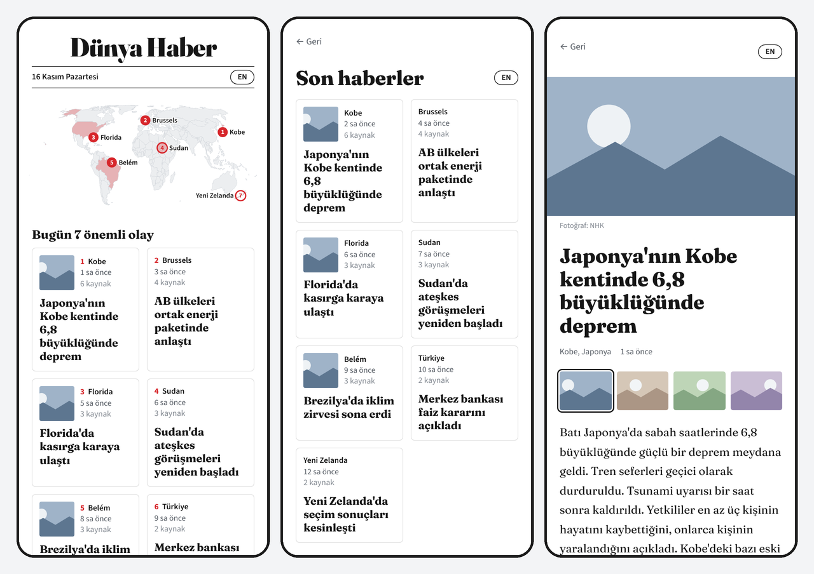
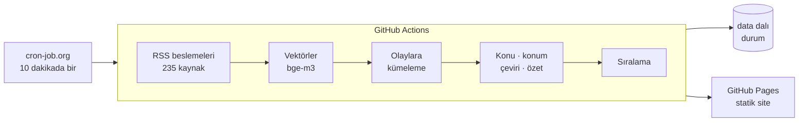

<div align="center">

# Dünya Haber

**Dünyada bugün ne oldu? Tek sayfada, sade ve ücretsiz.**

161 ülkeden 235 haber kaynağını 10 dakikada bir tarar, aynı olayı anlatan haberleri dil fark etmeksizin tek bir olayda birleştirir,
Türkçe ve İngilizce özetler ve her olayı haritada gösterir.

[**Siteyi aç →**](https://muhammedalibuke.github.io/dunya-haber/)

[](https://github.com/muhammedalibuke/dunya-haber/actions/workflows/update.yml)
[](https://github.com/muhammedalibuke/dunya-haber/actions/workflows/ci.yml)



<sub>Örnek verilerle çekilmiş ekran görüntüleri; fotoğraflar temsilidir.</sub>

</div>

---

## Ne yapar?

| | |
|---|---|
| **Aynı haber bir kez** | 10 farklı dilde 30 site aynı depremi yazsa da karşına tek bir olay çıkar. Altında "Bu olayı toplam 30 kaynak haberleştirdi" yazar. |
| **Günün özeti** | Ana ekranda, ülke dengesi gözetilerek seçilmiş 5–10 önemli olay ve dünya haritasında yerleri. Spor ve magazin buraya girmez. |
| **Son haberler** | Son 3 saatte ilk kez ortaya çıkan haberler, en yeniden eskiye. Büyük sitelerin son dakika haberleri ilk dakikalarda görünür. |
| **Haber sayfası** | Birden fazla kaynaktan derlenmiş özet, farklı kaynaklardan en fazla 4 fotoğraf, en çok okunan 5 kaynağa doğrudan bağlantı. |
| **İki dil** | Bütün başlıklar ve özetler Türkçe ve İngilizce. Tek dokunuşla geçiş. |
| **Telefonda uygulama gibi** | Tarayıcı menüsünden "Ana ekrana ekle" ile uygulama gibi açılır. |
| **Sıfır maliyet** | Sunucu yok, ücretli servis yok. Her şey GitHub Actions ve GitHub Pages üzerinde çalışır. |

## Nasıl çalışır?



1. **Toplama:** `config/sources.yaml` içindeki beslemeler paralel çekilir. Değişmeyen beslemeler tekrar indirilmez, bozuk ya da yavaş olanlar atlanır.
2. **Birleştirme:** Her haber çok dilli bir modelle (`BAAI/bge-m3`) vektöre çevrilir ve son 48 saatteki olaylarla karşılaştırılır. Sınırda kalan benzerliklerde ancak nadir bir ortak isim (ör. "Depardieu", "NYPD") varsa birleştirilir. Sonradan aynı olduğu anlaşılan olaylar da birleştirilir.
3. **Zenginleştirme:** Spor ve magazin etiketlenir. Olayın yeri GeoNames ve Natural Earth verisiyle internete çıkmadan bulunur. Başlıklar ve özetler Argos Translate ile çevrilir. Fotoğrafı olmayan haberlere haber sayfasındaki kapak fotoğrafı eklenir.
4. **Yayın:** Önem puanı ülke dengeli hesaplanır, site için JSON dosyaları üretilir ve GitHub Pages'e yüklenir. Durum `data` dalında tek bir commit olarak saklanır.

Bir güncelleme yaklaşık 1,5 dakika sürer.

## Kurulum (bir kez)

1. **Pages'i aç:** Settings → Pages → Build and deployment → Source: **GitHub Actions**
2. **Kaynakları kontrol et:** Actions → `check-sources` → Run workflow. Rapor, çalışmanın Artifacts kısmında.
3. **Zamanlayıcıyı kur:** GitHub'ın kendi zamanlayıcısı güvenilir değil, bu yüzden güncellemeleri [cron-job.org](https://cron-job.org) başlatır:
   - GitHub'da yalnızca bu depoya, yalnızca **Actions: Read and write** izni olan bir *fine-grained token* oluştur.
   - cron-job.org'da her 10 dakikada bir şu isteği gönderen bir görev kur:
     ```
     POST https://api.github.com/repos/muhammedalibuke/dunya-haber/actions/workflows/update.yml/dispatches
     Authorization: Bearer <token>
     Accept: application/vnd.github+json
     X-GitHub-Api-Version: 2022-11-28
     Content-Type: application/json

     {"ref":"main"}
     ```
   - GitHub'ın kendi zamanlayıcısı saatte bir yedek olarak çalışmaya devam eder.

> [!IMPORTANT]
> Token'ın süresi **10 Kasım 2027**'de doluyor. O tarihten önce yenileyip cron-job.org'daki `Authorization` satırını güncelle.

İlk çalıştırma modelleri indirdiği için uzun sürer. Çeviriye her çalıştırmada en fazla 8 dakika ayrılır, yetişmeyen çeviriler bir sonraki çalıştırmaya kalır.

## Sık yapılacaklar

| Ne | Nerede |
|---|---|
| Kaynak eklemek | `config/sources.yaml`: `id, name, url, country, lang, region, tier`. `tier` popülerliktir: 1 dünya çapında çok okunan, 2 büyük ulusal yayın, 3 diğer. Haber sayfasında en popüler 5 kaynak listelenir. |
| Yanlış yere düşen harita noktası | `config/place_stoplist.txt` (ör. kişi adı olan şehirler) |
| Spor/magazin anahtar kelimeleri | `config/topics.yaml` |
| Haber birleştirme hassasiyeti | `pipeline/cluster.py`: `CLUSTER_THRESHOLD` (0,72) ve `CLUSTER_LOW` (0,55) |
| Modelleri yeniden ölçmek | Actions → `calibrate` (54 etiketli zor örnek: `scripts/calibration/pairs.json`) |
| Yapay zekâ özeti (isteğe bağlı) | Settings → Secrets → Actions → `GEMINI_API_KEY`. Günün özetindeki olaylar için daha akıcı özetler üretir. Kota dolarsa sessizce normal özete döner. |

## Geliştirme

```bash
pip install -e ".[dev]"            # ağır modeller olmadan testler için yeterli
pytest                             # Python testleri
npm test                           # site testleri (node --test)

python scripts/make_dev_data.py    # örnek veri
python -m http.server              # → http://localhost:8000/site/?data=dev-data
```

<details>
<summary>Proje yapısı</summary>

```
config/            kaynaklar, konu anahtar kelimeleri, yer adı istisnaları
pipeline/          collect · embed · cluster · topics · geo · translate · summarize · images · rank · publish · run
site/              statik site (HTML, CSS, JS modülleri, harita verisi, d3-geo)
scripts/           kaynak kontrolü, model kurulumu, harita ve gazetteer üretimi, kalibrasyon
data/              çevrimdışı yer adları sözlüğü (GeoNames + Natural Earth)
docs/superpowers/  tasarım belgesi ve uygulama planı
.github/workflows/ update (10 dk) · ci · check-sources · calibrate
```

</details>

## Telif ve lisanslar

Haber başlıkları, kısa açıklamalar ve fotoğraflar ilgili yayıncılara aittir. Uygulama haberin tamamını göstermez, her zaman kaynağına bağlantı verir.

| Kullanılan | Lisans |
|---|---|
| [GeoNames](https://www.geonames.org/) yer adları | CC-BY 4.0 |
| [Natural Earth](https://www.naturalearthdata.com/) harita verisi | Kamu malı |
| [`BAAI/bge-m3`](https://huggingface.co/BAAI/bge-m3) (haber eşleştirme) | MIT |
| [`paraphrase-multilingual-MiniLM-L12-v2`](https://huggingface.co/sentence-transformers/paraphrase-multilingual-MiniLM-L12-v2) (konu etiketleme) | Apache-2.0 |
| [Argos Translate](https://github.com/argosopentech/argos-translate) (çeviri) | MIT |
| d3-geo, d3-array, topojson-client | ISC |
| Fraunces, Source Sans 3 (yazı tipleri) | SIL OFL |
